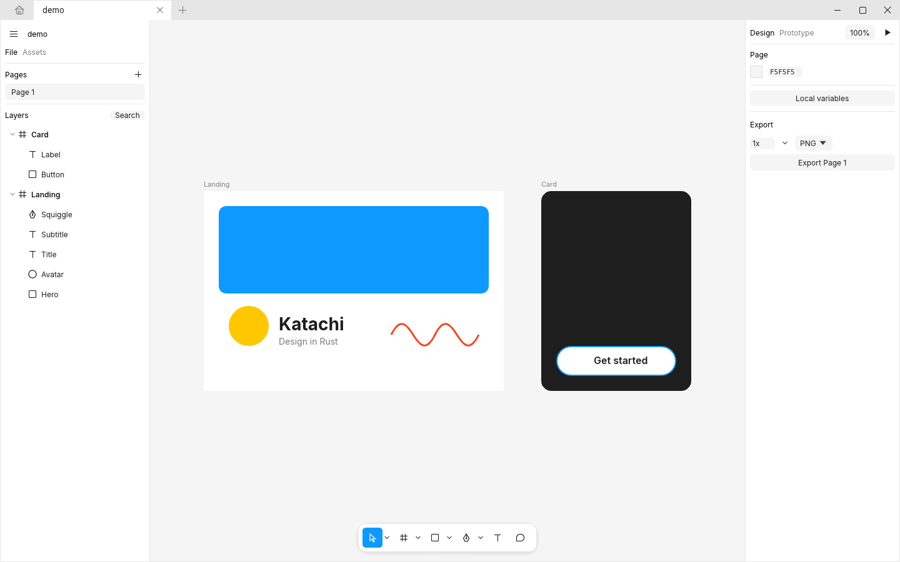

<p align="center"></p>

Katachi (形, "form") is a native design tool with Figma's workflow: the same canvas behavior, selection rules,
tools, panels, and keyboard shortcuts. It is written in Rust, runs offline, and stores files on your disk.

It is a clean-room implementation. No Figma code, assets, or file internals are used.


## Install

**macOS**

```sh
git clone https://github.com/dyascj/katachi && cd katachi
scripts/macos-app.sh --install   # builds Katachi.app into /Applications
```

**Linux** (x86_64 and arm64, X11 and Wayland)

Get the package for your distribution from the [latest release](https://github.com/dyascj/katachi/releases/latest):

```sh
sudo apt install ./katachi_*_amd64.deb          # Debian, Ubuntu, Mint, Pop!_OS, elementary
sudo dnf install ./katachi-*.x86_64.rpm         # Fedora, RHEL, Rocky, Alma, openSUSE (zypper)
tar xzf Katachi-linux-x86_64.tar.gz && katachi/linux-install.sh   # any distribution, no root
```

Builds run on glibc 2.28 and newer: Debian 11, Ubuntu 20.04, RHEL 8 and everything since. The
tarball installs into `~/.local` (app menu entry, icons, and `.katachi` files open on double-click);
`katachi/linux-install.sh --uninstall` removes it. From source:

```sh
git clone https://github.com/dyascj/katachi && cd katachi
cargo build --release && scripts/linux-install.sh   # needs only Rust and a C compiler
```



Good to know on Linux:
- Shortcuts use Ctrl where macOS uses Cmd, and menus show them that way. A few follow Figma's
  Windows bindings: layout guides Ctrl Shift 4, use as mask Ctrl Alt M, distribute and tidy up
  Alt Shift H / V / T.
- Tabs sit in the title bar with Katachi's own window buttons. Settings > Appearance > "Use the
  system title bar" switches to your desktop's.
- Many desktops take Ctrl Alt L (lock screen) and Ctrl Alt T (terminal), which Figma uses to align
  text left and center. Use the Text menu or quick actions for those, or free the keys in your
  desktop's keyboard settings.
- Alt-drag duplicates layers. If your desktop moves windows with Alt-drag (XFCE, MATE, Cinnamon,
  older Plasma), set its window-move key to Super.
- Glass needs a compositor and takes effect after a restart.
- On Wayland, dragging files in from a file manager isn't supported by the windowing library yet.
  Use Open or Place image (Shift Ctrl K), or start with `WAYLAND_DISPLAY= katachi` to run under XWayland.
- If the window stays black or the GPU misbehaves, start with `WGPU_BACKEND=gl katachi`.
- Open and save dialogs use the desktop portal (`xdg-desktop-portal`), or `zenity` when there's no portal.

**Any platform**

```sh
cargo install --path .
katachi [file.katachi]
```

Tagged releases (`v*`) build a universal macOS `.dmg`, a Windows `.zip`, and Linux `.deb`, `.rpm`, and `.tar.gz` packages for x86_64 and arm64 through
GitHub Actions. Building from source needs Rust 1.92 or newer. To cut a release, write `release-notes/vX.Y.Z.md`, bump the version in `Cargo.toml`, and push the tag; the workflow signs every asset and publishes those notes.

**Updates.** Installed release builds check GitHub for a newer release at launch. When there is one,
**Update now** appears in the tab strip: it downloads your platform's build, checks its signature
against the release key built into the app, tests that the new build runs on your system, swaps it
in, and restarts (after you save). Copies installed from a `.deb` or `.rpm` update with the next
package instead. Set `KATACHI_NO_UPDATE=1` to turn the check off.

## Features

**Files and tabs**
- Home: recent files as thumbnails, with search, New design file, and Open (Katachi or Figma `.fig`)
- Each file opens in its own tab, as in Figma's desktop app; Ctrl Tab switches, Cmd W closes
- Quick actions (Cmd / or Cmd K): search and run any command, tool, plugin, or layer
- Files and pages reopen where you left them

**Canvas and tools**
- Infinite canvas with pan, zoom, pixel grid at 800%+ (Shift '), snap to pixel grid (Shift Cmd '), rulers (Shift R), and smart guides
- Move, Scale (K), Hand, Zoom (Z), Frame, Section, Slice, Rectangle, Line, Arrow, Ellipse, Polygon, Star, Pen, Pencil, Text, Comment
- Frame presets for phones, tablets, desktops, slides, watches, paper, and social posts
- Figma's selection rules: click-through top-level frames, groups and instances select first, double-click to dive in, Cmd-click for deep select, pressing inside a selected parent drags the parent
- Resize from any edge or corner, rotate past the corners (Shift snaps to 15°), Alt-drag to duplicate
- Smart guides that snap to edges, centers, and equal spacing, with pink gap markers
- Smart selection: drag the pink handles between evenly spaced layers to respace them all, or drag a layer's center knob to swap places
- Ruler guides: drag them out of the rulers, move them, drag them back to delete; layers snap to them
- Alt-hover distance measurements, flip (Shift H/V), distribute and tidy up, alignment, N and Shift N to step through frames
- Right-click: Select layer (everything under the pointer), Move to page, Select matching layers, Select all with same fill, stroke, effect, font, or instance, Select inverse (Shift Cmd A)

**Layers and pages**
- Shift-click ranges, multi-layer drag to reorder and reparent, and the list scrolls to the selection
- Batch rename (Cmd R with several layers): rename to `$&`, `$n`, `$N`, and match and replace, with a preview
- Undo and redo bring back the selection and page of each step
- Pages: drag to reorder, duplicate, and dividers (a page named `---`)
- Resize to fit (Alt Shift Cmd R), remove fill, lock and unlock all, paste over selection (Shift Cmd V), paste to replace (Shift Cmd R) across tabs, and paste images straight from the clipboard

**Layout**
- Auto layout: horizontal, vertical, wrap, and grid (rows, columns, gaps, fill or fixed tracks, spans); gap or auto gap, padding, 3x3 alignment, text baseline alignment, canvas stacking order, hug / fill / fixed sizing, min and max width and height, strokes included in layout, absolute children (Shift A)
- Drag gap and padding handles on the canvas; arrow keys move a child through the flow
- Constraints (left, right, left and right, center, scale), with Cmd to resize without them
- Layout guides: grids, columns, and rows, with snapping (Ctrl G on macOS, Ctrl Shift 4 elsewhere)

**Design systems**
- Components and instances that keep overrides through main-component edits; push an instance's changes to its main component, or reset one property at a time
- Variants in component sets, with property dropdowns that keep overrides when switching
- Boolean, text, and instance-swap component properties, with preferred values and exposed nested instances
- Component descriptions, shown in Assets and Dev Mode
- Color, text, effect, and grid styles, edited in place from Local styles and grouped into folders with slash names
- Variables with collections, modes (for example Light and Dark), aliases, groups, scopes, and code syntax for web, iOS, and Android
- Bind variables to colors, sizes, spacing, radius, text, typography (font, weight, line height, letter spacing), min and max sizes, effects, and visibility, with Figma's "Apply variable" button on fills and strokes
- Assets panel with component previews, grouped by page; click or drag to place
- Libraries: use components, styles, and variables from other `.katachi` files, review updates when a library changes, and publish your own

**Vectors**
- Multi-contour paths with even-odd or non-zero fill
- Vector edit mode: move anchors and handles, marquee-select points, bend (Cmd-drag), cut (Y), join (Cmd J), continue a path with the pen, and edit polygons and stars
- Ellipse arcs: start, sweep, and ratio for pies, donuts, and rings
- Live boolean groups: union, subtract, intersect, exclude
- Flatten (Cmd E), outline stroke (Alt Cmd O), SVG import by paste, drag-and-drop, or File > Place

**Paint and effects**
- Solid, linear, radial, angular, and diamond gradients (elliptical, with Figma's handles on the canvas), and images (fill, fit, crop, stretch, tile) with exposure, contrast, saturation, temperature, tint, highlights, and shadows
- Figma's color picker: Hex, RGB, CSS, HSL, and HSB, colors on this page, color styles, and an eyedropper (I) with a loupe
- Several fills and strokes per layer, reordered by dragging, each with its own blend mode; Shift X swaps fill and stroke; number keys set opacity (5 = 50%, 4 then 5 = 45%)
- Strokes with inside / center / outside alignment, individual side weights, dashes, caps, joins, and arrow markers
- Drop shadow, inner shadow, layer and background blur (uniform or progressive), noise, texture, and glass, reordered by dragging; blend modes, masks, independent corner radii
- Selection colors: every color in a selection, editable in one place

**Text**
- System fonts with their real weights and italics, and a Replace fonts dialog for fonts that aren't installed
- Auto width / auto height / fixed boxes, left / center / right / justified, line height, letter spacing, paragraph spacing and indent, vertical trim, decoration, and case
- Rich text: mixed weights, sizes, colors, and italics within one text layer; bulleted and numbered lists (Shift Cmd 8, Shift Cmd 7); truncation with max lines; links (Cmd K while editing)
- Figma's text shortcuts: Cmd B / I / U, Shift Cmd X, Alt Cmd L / T / R / J, and size, weight, letter spacing, and line height steps

**Prototyping**
- Triggers: on click, while hovering, while pressing, mouse enter and leave, on drag, after delay, and key or gamepad
- Actions: navigate, back, scroll to, open, swap, and close overlays, open link, set variable, and change to (interactive components)
- Transitions: instant, dissolve, smart animate, move in, push, slide in; easing curves, custom bezier, and Gentle, Quick, Bouncy, and Slow springs
- Overlay position, close on outside click, and background; scrolling frames (horizontal, vertical, both) with fixed and sticky layers
- Present mode (Cmd Alt Enter) with flows, hotspot hints, overlays, and device frames (iPhone, Pixel, iPad, MacBook, Desktop)

**Collaboration**
- Real-time multiplayer: host a session from the app (Main menu > Collaborate) or run `katachi serve file.katachi`, and others join by address
- Sessions are protected by a code in the shared address; dropped connections reconnect on their own
- Live cursors, selections with name tags, text carets, and avatars; undo only reverts your own changes
- Cursor chat (/), follow a collaborator by clicking their avatar, and Spotlight me
- Comments pinned to frames, with replies, resolve, @mentions, filters, and unread markers

**Handoff**
- Dev Mode (Shift D) with CSS, Tailwind, SwiftUI, and Jetpack Compose code that uses your variable and style names, colors, type, and auto layout spacing on hover
- Ready for dev status on frames, and annotations pinned to layers
- Copy as PNG, SVG, CSS, or code

**Files**
- Open Figma `.fig` files (Main menu > Open, or drop one on the canvas): pages, frames, sections, components, component sets, instances with overrides and component properties, variables and modes, vectors, text, images, effects, auto layout, and constraints
- `.katachi` files (JSON), durable atomic saves, crash-recovery autosave for every tab, version history, open recent
- Export presets per layer to PNG, JPG, WebP, SVG, and PDF at any scale (2x, 2.5x) or size (512w, 512h), for several layers at once, and an Export dialog (Shift Cmd E) for everything on the page

**Appearance**
- Light, dark, or system theme (Main menu > Appearance). Pages left at the default canvas color follow the theme
- Glass: translucent, tinted side panels and toolbars over a blurred desktop, with adjustable opacity, blur (macOS), and tint; the canvas stays solid. On Windows and Linux glass is translucency without the blur

**MCP server (for AI agents)**
- The app serves MCP at `http://127.0.0.1:3855/mcp` while it's open, like Figma's Dev Mode MCP server, but agents can also edit: `claude mcp add --transport http katachi http://127.0.0.1:3855/mcp` (or Main menu > MCP server to copy the command). Stdio clients use `katachi mcp`
- Tools: `get_metadata` (XML outline), `get_screenshot`, `get_code` (CSS, SwiftUI, Compose), `get_variable_defs`, `get_components`, `get_selection`, `execute_code` (Figma plugin-API JavaScript, one undo step per call), `list_pages`, `set_page`, `select`, `import_svg`, `place_image`, `save`, `open_file`, `undo`

**Plugins**
- Run Figma plugins: Main menu > Plugins > Development > Import plugin from manifest. Plugins use the core of Figma's plugin API (`figma.currentPage`, selection, `findAll`, `create*`, fills, text, `notify`, `clientStorage`, `figma.on("selectionchange")`, async), and plugin UIs (`figma.showUI`) open in a panel with Figma's `postMessage` messaging (on Linux they open in your browser, connected the same way). Each change a plugin makes is one undo step
- Plugins > Development > Run script for quick one-off scripts; see `examples/plugins/tidy-names` and `examples/plugins/shape-maker`

| Auto layout | Components and variants |
| --- | --- |
|  |  |
| **Prototyping** | **Dev Mode** |
|  |  |

## Shortcuts

Cmd is Ctrl on Windows and Linux, and menus there show every shortcut with Ctrl, Alt, and Shift.

| Action | Keys |
| --- | --- |
| Move, Scale, Hand, Zoom | V, K, H, Z |
| Frame, Section, Slice | F or A, Shift S, S |
| Rectangle, Line, Arrow, Ellipse | R, L, Shift L, O |
| Pen, Pencil, Text, Comment | P, Shift P, T, C |
| Eyedropper, swap fill and stroke, opacity | I, Shift X, 0 to 9 |
| Undo, redo | Cmd Z, Shift Cmd Z |
| Copy, paste, cut, duplicate | Cmd C, Cmd V, Cmd X, Cmd D |
| Paste over selection, paste to replace | Shift Cmd V, Shift Cmd R |
| Copy and paste properties, copy as PNG | Alt Cmd C, Alt Cmd V, Shift Cmd C |
| Select all, inverse, matching layers | Cmd A, Shift Cmd A, Alt Cmd A |
| Rename (several layers: batch rename) | Cmd R |
| Group, frame selection, ungroup | Cmd G, Alt Cmd G, Shift Cmd G |
| Auto layout, remove auto layout | Shift A, Alt Shift A |
| Resize to fit | Alt Shift Cmd R |
| Create component, detach instance | Alt Cmd K, Alt Cmd B |
| Union, subtract, intersect, exclude | Alt Shift U, S, I, E |
| Flatten, use as mask | Cmd E, Ctrl Cmd M (Ctrl Alt M on Windows and Linux) |
| Join points, cut tool (vector edit) | Cmd J, Y |
| Bring forward, send backward | Cmd ], Cmd [ (add Alt for front and back) |
| Flip horizontal, vertical | Shift H, Shift V |
| Distribute, tidy up | Ctrl Alt H / V, Ctrl Alt T (Alt Shift H / V / T on Windows and Linux) |
| Show or hide, lock | Shift Cmd H, Shift Cmd L |
| Next and previous layer, select parent | Tab, Shift Tab, Shift Enter |
| Next and previous frame | N, Shift N |
| Zoom to fit, 100%, selection, in, out | Shift 1, Shift 0, Shift 2, Cmd +, Cmd - |
| Rulers, layout guides, pixel grid, snap to pixels | Shift R, Ctrl G (Ctrl Shift 4 on Windows and Linux), Shift ', Shift Cmd ' |
| Hide UI, outline mode | Cmd \, Cmd Y |
| Bold, italic, underline, strikethrough | Cmd B, Cmd I, Cmd U, Shift Cmd X |
| Align text left, center, right, justified | Alt Cmd L, T, R, J |
| Font size, weight, letter spacing, line height | Shift Cmd < >, Alt Cmd < >, Alt < >, Alt Shift < > |
| Numbered, bulleted list, link | Shift Cmd 7, Shift Cmd 8, Cmd K (while editing text) |
| Dev Mode, present | Shift D, Alt Cmd Enter |
| Save, open, place image, export | Cmd S, Cmd O, Shift Cmd K, Shift Cmd E |
| Quick actions, find and replace | Cmd / or Cmd K, Cmd F |
| Next and previous tab, close tab, quit | Ctrl Tab, Ctrl Shift Tab, Cmd W, Cmd Q |

## Roadmap

- The rest of the plugin API (styles, components, variables, and more node types)

## Development

```sh
cargo test                        # model, export, and headless UI interaction tests
cargo test shots -- --ignored     # render scripted screenshots to target/shots
cargo test --release perf -- --ignored --nocapture   # 5,000-layer frame timing
```

Code map:

| File | What it does |
| --- | --- |
| `src/doc.rs` | Document model: node tree, auto layout, constraints, components, styles, variables |
| `src/render.rs` | lyon tessellation into egui meshes, textures, raster fallback for blurs and blending |
| `src/canvas.rs` | Canvas input, tools, selection rules, snapping, overlays |
| `src/panels.rs` | Layers, Design panel, toolbar, icons |
| `src/export.rs` | SVG writer; PNG, JPG, and PDF via resvg and svg2pdf |
| `src/prototype.rs` | Present mode, interactions, transitions |
| `src/codegen.rs` | Dev Mode code generation |
| `src/collab.rs` | Multiplayer relay, diff sync, presence |
| `src/kiwi.rs`, `src/fig_import.rs` | Kiwi binary decoder and Figma `.fig` import |
| `src/text.rs` | Shared text layout and system fonts |
| `src/boolean.rs`, `src/vector_edit.rs`, `src/svg_import.rs` | Vector features |

## License

MIT, see [LICENSE](LICENSE). Inter is bundled under the SIL Open Font License (`assets/fonts/Inter-LICENSE.txt`).
