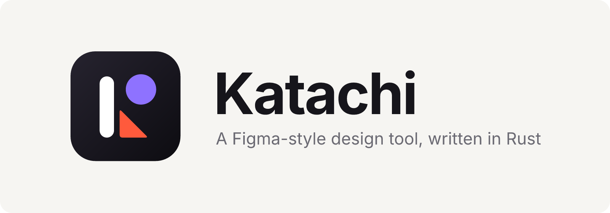
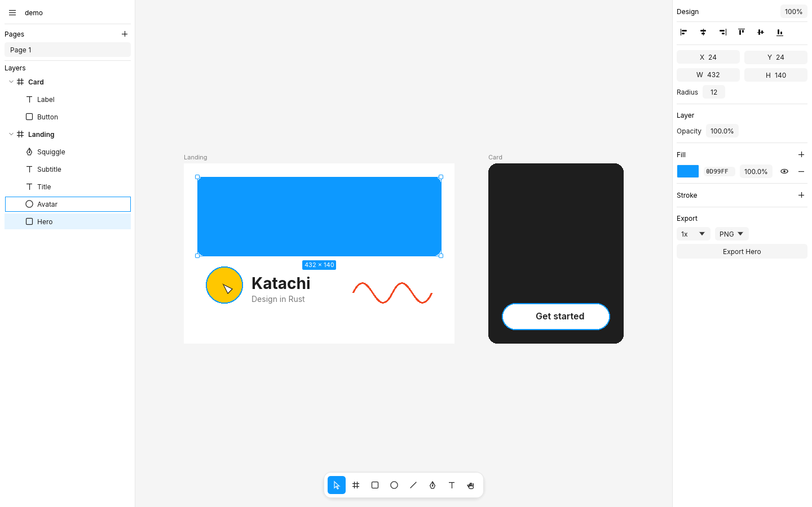
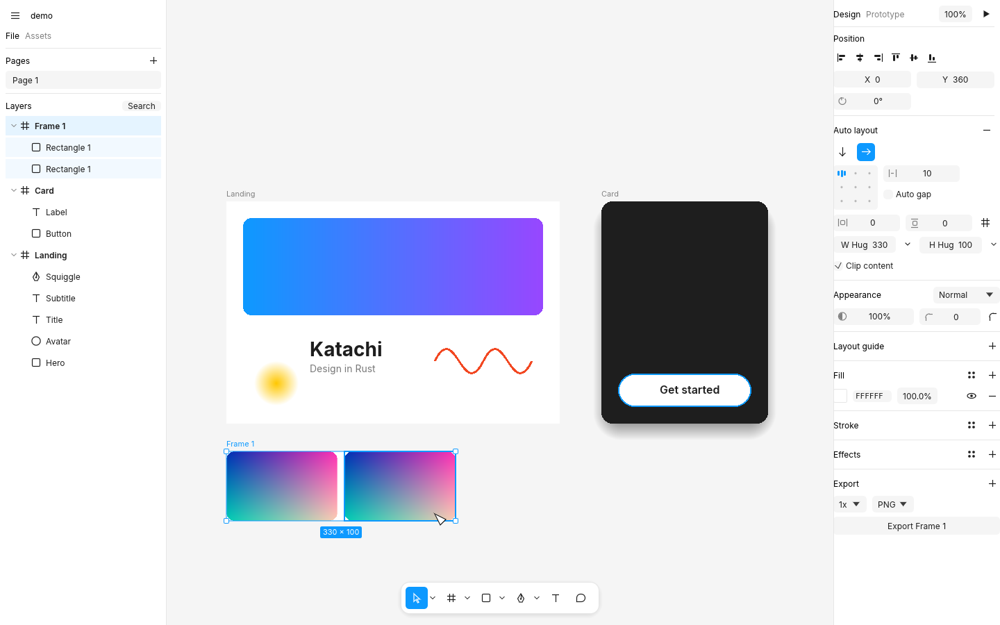
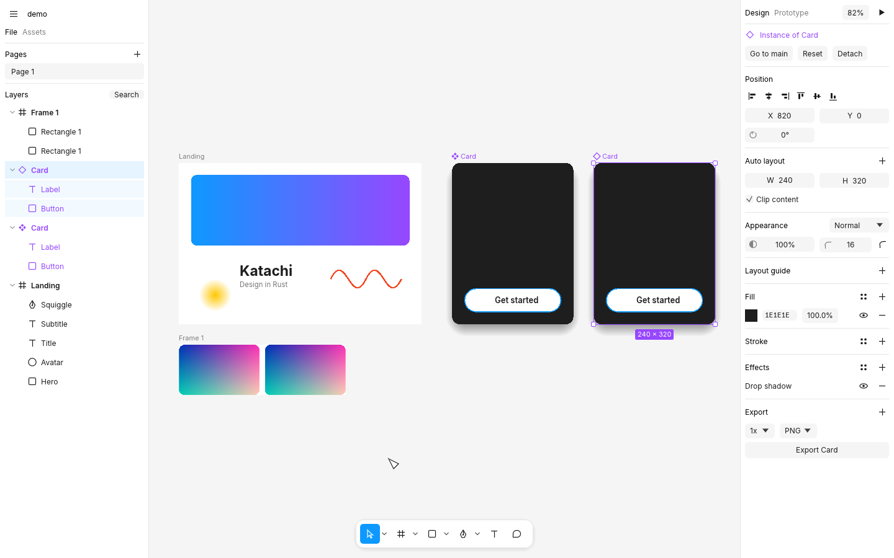
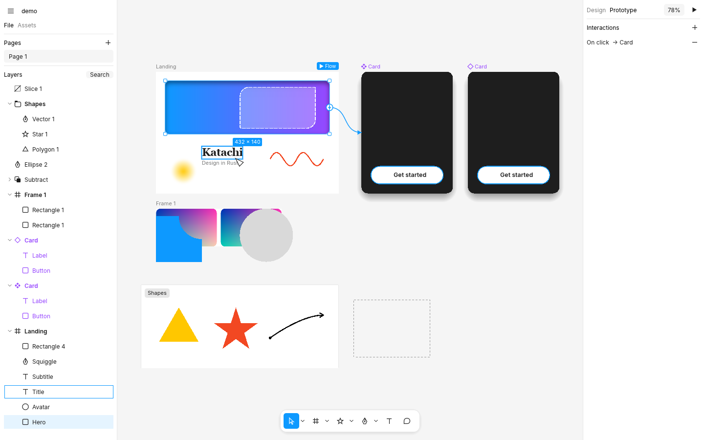
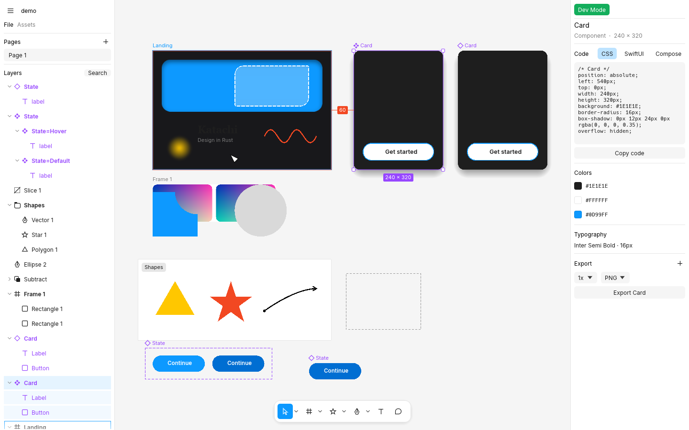

<p align="center"></p>

Katachi (形, "form") is a native design tool with Figma's workflow: the same canvas behavior, selection rules,
tools, panels, and keyboard shortcuts. It is written in Rust, runs offline, and stores files on your disk.

It is a clean-room implementation. No Figma code, assets, or file internals are used.



## Install

**macOS**

```sh
git clone https://github.com/dyascj/katachi && cd katachi
scripts/macos-app.sh --install   # builds Katachi.app into /Applications
```

**Linux**

```sh
sudo apt install libxkbcommon-dev libgtk-3-dev   # build dependencies (Debian/Ubuntu)
git clone https://github.com/dyascj/katachi && cd katachi
cargo build --release && scripts/linux-install.sh   # binary, icon, and app-menu entry
```

From a release tarball, unpack it and run `./linux-install.sh`.

**Any platform**

```sh
cargo install --path .
katachi [file.katachi]
```

Tagged releases (`v*`) build a universal macOS `.dmg`, a Windows `.zip`, and a Linux `.tar.gz` through
GitHub Actions. Building from source needs Rust 1.92 or newer.

**Updates.** Installed release builds check GitHub for a newer release at launch. When there is one,
**Update now** appears in the tab strip: it downloads your platform's build, checks its signature
against the release key built into the app, swaps it in, and restarts. Set `KATACHI_NO_UPDATE=1` to
turn the check off.

## Features

**Files and tabs**
- Home: recent files as thumbnails, with search, New design file, and Open (Katachi or Figma `.fig`)
- Each file opens in its own tab, as in Figma's desktop app; Ctrl Tab switches, Cmd W closes
- Quick actions (Cmd / or Cmd K): search and run any command, tool, plugin, or layer
- Files and pages reopen where you left them

**Canvas and tools**
- Infinite canvas with pan, zoom, pixel grid at 800%+, rulers (Shift R), and smart guides
- Move, Scale (K), Frame, Section, Slice, Rectangle, Line, Arrow, Ellipse, Polygon, Star, Pen, Pencil, Text, Comment
- Frame presets for phones, tablets, desktops, slides, watches, paper, and social posts
- Figma's selection rules: click-through top-level frames, groups and instances select first, double-click to dive in, Cmd-click for deep select, pressing inside a selected parent drags the parent
- Resize from any edge or corner, rotate past the corners (Shift snaps to 15°), Alt-drag to duplicate
- Alt-hover distance measurements, flip (Shift H/V), distribute and tidy up, alignment

**Layout**
- Auto layout: direction, wrap with row gap, gap or auto gap, padding, 3x3 alignment, hug / fill / fixed sizing, min and max width and height, strokes included in layout, absolute children, live drag reordering (Shift A)
- Constraints (left, right, left and right, center, scale), with Cmd to resize without them
- Layout guides: grids, columns, and rows, with snapping (Ctrl G to show or hide)

**Design systems**
- Components and instances that keep overrides through main-component edits
- Variants in component sets, with property dropdowns that keep overrides when switching
- Boolean, text, and instance-swap component properties
- Color, text, and effect styles
- Variables with collections and modes (for example Light and Dark), aliases, and bindings for colors, sizes, spacing, radius, text, and visibility
- Assets panel with component previews, grouped by page, to drag onto the canvas
- Swap instances, add variants from the right-click menu, and group styles into folders with slash names

**Vectors**
- Multi-contour paths with even-odd or non-zero fill, vector edit mode for anchors and handles (point position, bend, delete)
- Ellipse arcs: start, sweep, and ratio for pies, donuts, and rings
- Live boolean groups: union, subtract, intersect, exclude
- Flatten (Cmd E), outline stroke (Alt Cmd O), SVG import by paste, drag-and-drop, or File > Place

**Paint and effects**
- Solid, linear, and radial gradient fills, and images (fill, fit, crop, stretch, tile) with exposure, contrast, saturation, temperature, tint, highlights, and shadows
- Strokes with inside / center / outside alignment, individual side weights, dashes, caps, joins, and arrow markers
- Drop shadow, inner shadow, layer blur, background blur, blend modes, masks, independent corner radii
- Selection colors: every color in a selection, editable in one place

**Text**
- System fonts, auto width / auto height / fixed boxes, alignment, line height, letter spacing, decoration, and case

**Prototyping**
- Interactions (click, hover, press, after delay) with navigate, back, overlays, and links
- Transitions: instant, dissolve, smart animate, move in, push, slide in
- Present mode (Cmd Alt Enter) with flows, hotspot hints, and overlays

**Collaboration**
- Real-time multiplayer: host a session from the app (Main menu > Collaborate) or run `katachi serve file.katachi`, and others join by address
- Live cursors, selections, and avatars; undo only reverts your own changes
- Comments pinned to frames, with replies and resolve

**Handoff**
- Dev Mode (Shift D) with CSS, SwiftUI, and Jetpack Compose code, colors, and type
- Rich text: mixed weights, sizes, colors, and italics within one text layer; bulleted and numbered lists (Shift Cmd 8, Shift Cmd 7); paragraph spacing; truncation with max lines

**Files**
- Open Figma `.fig` files (Main menu > Open, or drop one on the canvas): pages, frames, sections, components, component sets, instances with overrides and component properties, variables and modes, vectors, text, images, effects, auto layout, and constraints
- `.katachi` files (JSON), atomic saves, crash-recovery autosave, version history, open recent
- Export presets per layer to PNG, JPG, SVG, and PDF

**Appearance**
- Light, dark, or system theme (Main menu > Appearance). Pages left at the default canvas color follow the theme
- Glass: translucent, tinted side panels and toolbars over a blurred desktop, with adjustable opacity, blur (macOS), and tint; the canvas stays solid. On Windows and Linux glass is translucency without the blur

**MCP server (for AI agents)**
- The app serves MCP at `http://127.0.0.1:3855/mcp` while it's open, like Figma's Dev Mode MCP server, but agents can also edit: `claude mcp add --transport http katachi http://127.0.0.1:3855/mcp` (or Main menu > MCP server to copy the command). Stdio clients use `katachi mcp`
- Tools: `get_metadata` (XML outline), `get_screenshot`, `get_code` (CSS, SwiftUI, Compose), `get_variable_defs`, `get_components`, `get_selection`, `execute_code` (Figma plugin-API JavaScript, one undo step per call), `list_pages`, `set_page`, `select`, `import_svg`, `place_image`, `save`, `open_file`, `undo`

**Plugins**
- Run Figma plugins: Main menu > Plugins > Development > Import plugin from manifest. Plugins use the core of Figma's plugin API (`figma.currentPage`, selection, `findAll`, `create*`, fills, text, `notify`, `clientStorage`, `figma.on("selectionchange")`, async), and plugin UIs (`figma.showUI`) open in a panel with Figma's `postMessage` messaging (on Linux they open in your browser, connected the same way). Each change a plugin makes is one undo step
- Plugins > Development > Run script for quick one-off scripts; see `examples/plugins/tidy-names` and `examples/plugins/shape-maker`

| Auto layout | Components and variants |
| --- | --- |
|  |  |
| **Prototyping** | **Dev Mode** |
|  |  |

## Shortcuts

| Action | Keys |
| --- | --- |
| Move, Scale, Hand | V, K, H |
| Frame, Section, Slice | F or A, Shift S, S |
| Rectangle, Line, Arrow, Ellipse | R, L, Shift L, O |
| Pen, Pencil, Text, Comment | P, Shift P, T, C |
| Undo, redo | Cmd Z, Shift Cmd Z |
| Copy, paste, cut, duplicate | Cmd C, Cmd V, Cmd X, Cmd D |
| Copy and paste properties | Alt Cmd C, Alt Cmd V |
| Group, frame selection, ungroup | Cmd G, Alt Cmd G, Shift Cmd G |
| Auto layout, remove auto layout | Shift A, Alt Shift A |
| Create component, detach instance | Alt Cmd K, Alt Cmd B |
| Union, subtract, intersect, exclude | Alt Shift U, S, I, E |
| Flatten, use as mask | Cmd E, Ctrl Cmd M |
| Bring forward, send backward | Cmd ], Cmd [ (add Alt for front and back) |
| Flip horizontal, vertical | Shift H, Shift V |
| Distribute, tidy up | Ctrl Alt H / V, Ctrl Alt T |
| Show or hide, lock | Shift Cmd H, Shift Cmd L |
| Next and previous layer, select parent | Tab, Shift Tab, Shift Enter |
| Zoom to fit, 100%, selection | Shift 1, Shift 0, Shift 2 |
| Rulers, layout guides, hide UI, outline mode | Shift R, Ctrl G, Cmd \, Cmd Y |
| Dev Mode, present | Shift D, Alt Cmd Enter |
| Save, open, place image, export | Cmd S, Cmd O, Shift Cmd K, Shift Cmd E |
| Quick actions | Cmd / or Cmd K |
| Find and replace | Cmd F |
| Next and previous tab, close tab | Ctrl Tab, Ctrl Shift Tab, Cmd W |
| Copy as PNG, paste to replace, select matching layers | Shift Cmd C, Shift Cmd R, Alt Cmd A |
| Copy and paste properties | Alt Cmd C, Alt Cmd V |
| Numbered, bulleted list | Shift Cmd 7, Shift Cmd 8 |

## Roadmap

- The rest of the plugin API (styles, components, variables, and more node types)

## Development

```sh
cargo test                        # model, export, and headless UI interaction tests
cargo test shots -- --ignored     # render scripted screenshots to target/shots
cargo test --release perf -- --ignored --nocapture   # 5,000-layer frame timing
```

Code map:

| File | What it does |
| --- | --- |
| `src/doc.rs` | Document model: node tree, auto layout, constraints, components, styles, variables |
| `src/render.rs` | lyon tessellation into egui meshes, textures, raster fallback for blurs and blending |
| `src/canvas.rs` | Canvas input, tools, selection rules, snapping, overlays |
| `src/panels.rs` | Layers, Design panel, toolbar, icons |
| `src/export.rs` | SVG writer; PNG, JPG, and PDF via resvg and svg2pdf |
| `src/prototype.rs` | Present mode, interactions, transitions |
| `src/codegen.rs` | Dev Mode code generation |
| `src/collab.rs` | Multiplayer relay, diff sync, presence |
| `src/kiwi.rs`, `src/fig_import.rs` | Kiwi binary decoder and Figma `.fig` import |
| `src/text.rs` | Shared text layout and system fonts |
| `src/boolean.rs`, `src/vector_edit.rs`, `src/svg_import.rs` | Vector features |

## License

MIT, see [LICENSE](LICENSE). Inter is bundled under the SIL Open Font License (`assets/fonts/Inter-LICENSE.txt`).
